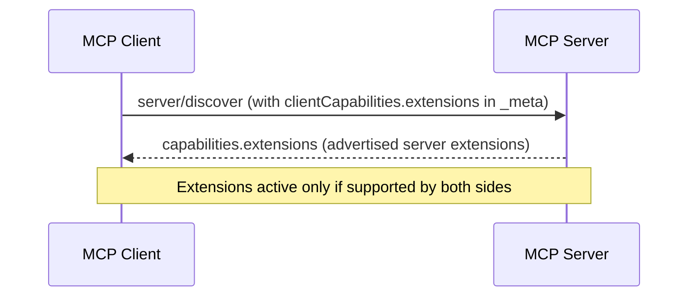

# MCP Extensions & Apps

MCP extensions are modular capabilities beyond the core 2026-07-28 specification. They allow servers and clients to negotiate rich features—such as interactive HTML applications, asynchronous task execution, and agent skills—while preserving graceful degradation for standard clients.

## Overview of Official Extensions

Extensions use reverse-domain vendor prefixed identifiers. The official MCP extensions live under the `io.modelcontextprotocol` namespace:

| Extension | Identifier | Primary Purpose |
| :--- | :--- | :--- |
| **MCP Apps** | `io.modelcontextprotocol/ui` | Interactive graphical interfaces (dashboards, forms, charts) rendered in sandboxed iframes |
| **Tasks** | `io.modelcontextprotocol/tasks` | Asynchronous, long-running operations with durable task handles, polling, and mid-flight inputs |
| **Skills** | `io.modelcontextprotocol/skills` | Discover and read reusable Agent Skills and supporting files via MCP resources |
| **OAuth Client Credentials** | `io.modelcontextprotocol/oauth-client-credentials` | Machine-to-machine authentication without interactive user prompts |
| **Enterprise Auth** | `io.modelcontextprotocol/enterprise-managed-authorization` | Centralized corporate SSO and identity provider (IdP) authorization |

## Extension Negotiation

Extensions in MCP are strictly **opt-in**. Neither server nor client enables extension-specific behavior unless both declare support during capability exchange.



### Client Declaration

The client declares supported extensions in `_meta["io.modelcontextprotocol/clientCapabilities"].extensions` with each request:

```json
{
  "jsonrpc": "2.0",
  "id": 1,
  "method": "tools/call",
  "params": {
    "name": "open_dashboard",
    "_meta": {
      "io.modelcontextprotocol/protocolVersion": "2026-07-28",
      "io.modelcontextprotocol/clientCapabilities": {
        "extensions": {
          "io.modelcontextprotocol/ui": {
            "mimeTypes": ["text/html;profile=mcp-app"]
          }
        }
      }
    }
  }
}
```

In Zig:

```zig
var client = mcp.Client.init(allocator, .{
    .name = "MyClient",
    .version = "1.0.0",
});
defer client.deinit();

// Advertise support for MCP Apps UI extension
try client.enableUi();
```

### Server Declaration

The server advertises supported extensions in its `server/discover` response:

```json
{
  "jsonrpc": "2.0",
  "id": 1,
  "result": {
    "protocolVersion": "2026-07-28",
    "supportedVersions": ["2026-07-28"],
    "capabilities": {
      "tools": {},
      "resources": {},
      "extensions": {
        "io.modelcontextprotocol/ui": {}
      }
    },
    "resultType": "complete"
  }
}
```

In Zig:

```zig
var server = mcp.Server.init(allocator, .{
    .name = "MyServer",
    .version = "1.0.0",
});
defer server.deinit();

// Advertise support for MCP Apps UI extension
try server.enableUi();
```

---

## MCP Apps (`io.modelcontextprotocol/ui`)

[MCP Apps](https://modelcontextprotocol.io/extensions/apps/overview) allow servers to return rich, interactive HTML interfaces that render directly inside host applications (such as Claude Desktop, Zed, Goose, or custom web portals).

### How MCP Apps Work

Traditional MCP tools return text, markdown, or structured JSON. MCP Apps extend this by pairing two primitives:

1. **A UI Resource**: An HTML document served with MIME type `text/html;profile=mcp-app` (`mcp.MIME_TYPE_MCP_APP`).
2. **A Tool with `_meta.ui`**: A tool whose definition contains `_meta.ui.resourceUri` pointing to the UI resource URI.

When an AI host invokes or preloads the tool:
* The host reads the UI resource from the server via `resources/read`.
* The host renders the HTML inside a sandboxed `<iframe>`.
* The tool call execution returns a `ToolResult` with `_meta.ui.resourceUri`, which the host immediately routes to the active iframe.
* The embedded app communicates with the host via JSON-RPC over `postMessage`.

### Defining UI Resources

Use `mcp.ResourceBuilder` with `.mcpApp()` to expose UI resources:

```zig
var dash_builder = mcp.ResourceBuilder.init("ui://dashboard/interactive", "Dashboard");
_ = dash_builder
    .title("Interactive System Dashboard")
    .description("Live interactive metrics and control panel")
    .mcpApp() // sets MIME type to text/html;profile=mcp-app
    .handler(dashboardHandler);

try server.addResource(dash_builder.build());
```

### Linking Tools to UI

Use `ToolBuilder.ui()` or `ToolBuilder.uiWithVisibility()` to attach UI metadata to a tool:

```zig
var tool_builder = mcp.ToolBuilder.init("open_dashboard");
_ = try tool_builder
    .title("Open Interactive Dashboard")
    .description("Launches the real-time system metrics interface")
    .readOnly()
    .idempotent()
    .ui(allocator, "ui://dashboard/interactive");

_ = tool_builder.handler(openDashboardHandler);
try server.addTool(tool_builder.build());
```

In the handler, return a `ToolResult` carrying UI metadata using `mcp.uiResult()`:

```zig
fn openDashboardHandler(
    _: ?*anyopaque,
    _: std.Io,
    allocator: std.mem.Allocator,
    _: ?std.json.Value,
) mcp.tools.ToolError!mcp.ToolResult {
    return mcp.uiResult(
        allocator,
        "ui://dashboard/interactive",
        "Dashboard ready. The interactive interface is active in your viewport.",
    ) catch return mcp.tools.ToolError.OutOfMemory;
}
```

### Working Example

See the complete runnable server in [`examples/mcp_app_server.zig`](https://github.com/muhammad-fiaz/mcp.zig/blob/main/examples/mcp_app_server.zig) and its documentation in [MCP Apps Server Example](/examples/mcp-app-server).

---

## MCP Tasks (`io.modelcontextprotocol/tasks`)

The Tasks extension decouples long-running operations from synchronous request timeouts. Instead of blocking the connection, the server creates a durable task handle and returns a `CreateTaskResult` with `resultType: "task"`.

### Task States

| State | Description |
| :--- | :--- |
| `working` | The operation is actively executing in the background |
| `input_required` | The server paused execution and requires client or human input (`inputRequests`) |
| `completed` | The task finished successfully; final output is in the `result` field |
| `failed` | An error occurred during execution; details are in the `error` field |
| `cancelled` | The task was cancelled via `tasks/cancel` |

### Server Setup for Tasks

```zig
var server = mcp.Server.init(allocator, .{
    .name = "task-server",
    .version = "1.0.0",
});
defer server.deinit();

// Enables task management endpoints (tasks/get, tasks/update, tasks/cancel)
try server.enableTasks();
```

---

## Skills over MCP (`io.modelcontextprotocol/skills`)

The Skills extension allows servers to publish reusable [Agent Skills](https://agentskills.io) with `SKILL.md` instructions and supporting reference files over MCP.

* **Discovery**: Clients query `skills/list` to inspect available skills, YAML frontmatter, and file manifests.
* **Retrieval**: Individual skills are fetched using `skills/get` with their canonical `skill://` URI.
* **Execution**: Skill instructions and supporting files are retrieved on demand using standard `resources/read`.

---

## Graceful Degradation

If a connected client does not declare support for an extension:
* **UI Tools**: Fall back gracefully by delivering clear text content in `ToolResult.content` alongside the optional `_meta.ui`.
* **Tasks**: Complete operations synchronously when possible, or return standard JSON-RPC errors when long-running background tasks cannot proceed without client polling.
